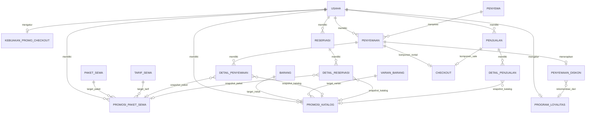

# ARD-001 — Event & Promosi: Promo Katalog, Paket, Loyalitas, dan Promo Checkout

**Produk:** Akasha Outdoor — Rental Admin <br>
**Dokumen:** Architecture Requirements & Design (ARD) <br>
**Status:** Draft arsitektur untuk menjadi baseline implementasi <br>
**Tanggal:** 5 November 2026 <br>
**Cakupan utama:** `rental-admin/`, Supabase PostgreSQL, Walk-in Rental, Katalog, Penjualan, Reservasi, Checkout Gabungan, dan Keuangan <br>
**Keputusan loyalitas:** Model A — kelayakan berkelanjutan setelah ambang penyewaan selesai tercapai.

---

## 0. Ringkasan keputusan arsitektur

Modul **Event & Promosi** menjadi satu pusat administrasi untuk mengelola seluruh kebijakan promo usaha. Halaman ini menyatukan kontrol promo barang/varian, promo paket, program loyalitas, dan kebijakan diskon checkout. Sentralisasi ini berlaku pada **pengelolaan dan pengalaman admin**, bukan berarti semua jenis promo harus dipaksa masuk ke satu tabel atau satu algoritme diskon.

Sistem promosi dibagi menjadi empat domain:

1. **Promo Katalog** — diskon persentase pada baris barang atau varian, dengan channel `rental` atau `sale` yang independen.
2. **Promo Paket Rental** — melanjutkan mekanisme `promosi_paket_sewa` yang sudah ada; harga promo paket tetap nominal dan tidak digabung dengan promo komponen.
3. **Loyalitas Penyewa** — sistem menghitung jumlah transaksi rental yang selesai dan memberikan rekomendasi promo. Setelah ambang tercapai, kelayakan berlaku berkelanjutan selama kebijakan aktif. Tidak ada poin, wallet, voucher, klaim, atau redemption ledger.
4. **Promo Checkout** — admin menerapkan diskon nominal atau persentase pada subtotal rental melalui Walk-in. Sistem dapat mengisi nilai rekomendasi loyalitas; admin dapat menerima, mengubah, atau memberikan bonus tambahan sesuai batas kewenangan dan kebijakan usaha.

### Keputusan yang sudah ditetapkan pengguna

- Loyalitas menggunakan **Model A**: setelah pelanggan mencapai ambang completed rental, pelanggan memenuhi syarat secara berkelanjutan selama program aktif. Jumlah transaksi yang jauh melewati ambang tidak menghilangkan kelayakan.
- Ambang loyalitas dapat dikonfigurasi per usaha; contoh awal adalah setiap 10 penyewaan selesai.
- Program loyalitas dapat diaktifkan dan dinonaktifkan, serta persentase rekomendasinya dapat diubah.
- Saat penyewa dipilih di Walk-in, sistem menampilkan histori jumlah penyewaan, status kelayakan, dan estimasi promo.
- Admin harus menekan **Pakai Promo** untuk menerapkan rekomendasi. Admin juga dapat memasukkan diskon manual dan memberikan nilai lebih besar sebagai bonus tambahan.
- Promo loyalitas tidak membutuhkan mekanisme poin, voucher, klaim, atau penukaran terpisah.
- Semua kebijakan promo dikelola melalui satu halaman Event & Promosi.
- Promo barang dan promo paket tetap menjadi bagian penting dan harus tercakup dalam desain, bukan hanya promo loyalitas dan checkout.

### Keputusan desain yang direkomendasikan dalam dokumen ini

- Promo tingkat baris dihitung sebelum diskon tingkat transaksi.
- Promo loyalitas dan diskon manual merupakan **satu diskon checkout rental**; keduanya tidak dijumlahkan sebagai dua diskon terpisah.
- Tombol **Pakai Promo** mengisi nilai diskon aktual berdasarkan rekomendasi. Admin boleh mengubah nilai aktual; selisih positif dicatat sebagai bonus/override, bukan sebagai baris diskon kedua.
- Diskon checkout hanya mengurangi kewajiban rental, tidak mengurangi harga atau omzet barang yang dijual dalam checkout gabungan.
- Promo paket tidak menerima promo produk/varian pada komponen paket.
- Harga final, kelayakan, batas diskon, snapshot, dan total transaksi selalu diverifikasi di backend.
- Diskon bukan pembayaran, bukan biaya operasional, dan tidak membuat mutasi akun keuangan.

---

## 1. Tujuan dan prinsip desain

### 1.1 Tujuan bisnis

1. Memberi alat bagi pemilik usaha/admin untuk membuat dan mengendalikan promo tanpa membuka banyak halaman operasional.
2. Mendorong penjualan dan rental melalui harga promo produk, varian, dan paket.
3. Meningkatkan retensi penyewa melalui rekomendasi loyalitas yang mudah dipahami dan tidak membutuhkan administrasi reward rumit.
4. Memberi admin kasir kendali yang terukur untuk diskon checkout, termasuk promo pelanggan dan bonus khusus.
5. Menjaga harga yang ditawarkan, harga yang disepakati, nilai tagihan, pembayaran, dan laporan tetap konsisten.
6. Menjaga jejak audit: siapa mengaktifkan promo, siapa menerapkan diskon, berapa rekomendasi, berapa diskon aktual, dan mengapa.

### 1.2 Prinsip arsitektur

- **One configuration surface, multiple domain models.** Semua konfigurasi tersedia pada satu halaman; tabel dan aturan domain tetap dipisah.
- **Backend is the pricing authority.** Frontend hanya menampilkan preview dan mengirim intent admin. Frontend bukan sumber kebenaran harga.
- **No base-price mutation.** Promo tidak mengubah `tarif_sewa.nominal`, `barang.harga_jual`, atau `varian_barang.harga_jual`.
- **Snapshot at transaction boundary.** Harga normal, promo yang dipakai, diskon, dan nilai akhir disimpan sebagai snapshot saat transaksi dibuat/dipesan.
- **No accidental stacking.** Satu target hanya menerima satu promo katalog paling spesifik; promo paket tidak ditumpuk dengan promo komponennya; satu rental hanya menerima satu diskon checkout.
- **Tenant isolation.** Seluruh data, query, RPC, dan FK harus dibatasi dengan `usaha_id`.
- **Operational simplicity.** Admin melihat informasi dalam konteks keranjang dan melakukan keputusan tanpa berpindah halaman atau membuka dialog yang tidak perlu.
- **Immutable financial history.** Perubahan konfigurasi promo tidak boleh mengubah transaksi historis.
- **Idempotent commands.** Perubahan konfigurasi maupun checkout harus mempunyai idempotency key, request ID, dan rekonsiliasi outcome.

### 1.3 Non-goals tahap pertama

- Poin pelanggan, wallet reward, voucher, kupon, kode referral, dan penukaran hadiah.
- Promo bertingkat/cascade yang menggabungkan banyak persentase pada satu baris.
- Diskon untuk item penjualan yang dipicu oleh loyalitas rental.
- Diskon otomatis untuk website publik berdasarkan histori pelanggan.
- Campaign/event marketing generik dengan segmentasi, kuota, kode kupon, dan audience engine.
- Mengubah HPP, stok, atau harga dasar katalog karena promo.
- Mencatat diskon sebagai pembayaran, pengeluaran, atau mutasi akun keuangan.

Istilah **Event & Promosi** pada tahap ini adalah nama pusat pengelolaan promosi; bukan permintaan untuk membangun campaign-management engine generik.

---

## 2. Kondisi sistem aktual yang menjadi baseline

Bagian ini dicatat berdasarkan pemeriksaan repository `rental-admin/` dan Supabase project yang sedang terhubung. Ini adalah kondisi awal desain, bukan pernyataan bahwa fitur baru telah diimplementasikan.

### 2.1 Komponen yang sudah tersedia

| Komponen | Kondisi aktual | Implikasi desain |
|---|---|---|
| `promosi_paket_sewa` | Sudah ada | Dipertahankan dan dikelola dari halaman pusat; tidak dibuat ulang. |
| `resolve_package_promo_price()` | Sudah ada di `app_private` | Tetap menjadi resolver promo paket, dengan penyesuaian bila mendukung jadwal berakhir. |
| `command_set_paket_promo` | Sudah ada | Dapat menjadi command dasar pengelolaan promo paket; kontrak tanggal perlu diperluas bila diperlukan. |
| `detail_penyewaan.promosi_paket_id` | Sudah ada | Referensi snapshot promo paket pada detail rental. |
| `detail_reservasi.promosi_paket_id` | Sudah ada | Referensi snapshot promo paket pada detail reservasi. |
| `tarif_sewa.nominal` | Sudah ada | Harga dasar rental. Tidak boleh ditimpa promo. |
| `barang.harga_jual` dan `varian_barang.harga_jual` | Sudah ada | Harga dasar penjualan. Tidak boleh ditimpa promo. |
| `penyewaan.total_amount` | Sudah ada | Nilai akhir rental saat ini; jangan menambahkan kolom total duplikat. |
| `checkout` | Sudah ada | Menyimpan subtotal rental, subtotal penjualan, total, pembayaran, dan status. Constraint total saat ini belum mengenal diskon checkout. |
| `command_create_mixed_checkout` | Sudah ada | Perlu diperluas untuk menerima diskon rental secara atomik. |
| `command_create_mixed_checkout_and_activate` | Sudah ada | Harus menggunakan pricing/discount contract yang sama dengan checkout gabungan draft. |
| Idempotency, audit log, outbox | Sudah menjadi pola sistem | Wajib dipertahankan untuk seluruh promo mutation dan checkout. |

### 2.2 Keterbatasan aktual yang harus diselesaikan

1. Belum ada tabel `promosi_katalog`, `program_loyalitas`, maupun `penyewaan_diskon`.
2. `penyewaan` belum memiliki `subtotal_amount` dan `discount_amount`; `total_amount` sudah tersedia.
3. `detail_penyewaan` dan `detail_reservasi` sudah menyimpan tarif dan promo paket, tetapi belum menyimpan snapshot promo katalog produk/varian.
4. `detail_penjualan` belum menyimpan referensi promo katalog, harga normal, persentase diskon, dan nominal diskon baris.
5. Trigger `validate_rental_line_math()` mengharuskan `unit_price` sama dengan tarif normal kecuali untuk jalur promo paket yang dikenal. Promo katalog rental harus dimasukkan ke trigger/validator ini; jika tidak, insert detail akan ditolak.
6. `checkout_total_math` saat ini memeriksa `total_amount = subtotal_rental + subtotal_penjualan`. Constraint tersebut harus diubah agar mengenal diskon rental.
7. `checkout_paid_limit` memastikan `amount_paid <= total_amount`; pembayaran harus tetap dibatasi terhadap kewajiban akhir setelah diskon.
8. Promo paket saat ini dikonfigurasi melalui bagian Katalog. `src/pages/katalog/list.tsx` memuat editor promo paket dan menggunakan `setCatalogPackagePromo()`. Pada target akhir, konfigurasi dipusatkan ke Event & Promosi, sedangkan katalog tetap menampilkan badge/harga efektif dan tautan menuju pengelolaan promo.
9. Tabel `promosi_paket_sewa` saat ini mempunyai `started_at` dan `ended_at`, tetapi `ended_at` digunakan sebagai waktu promo benar-benar diakhiri. Belum ada field terpisah untuk tanggal akhir yang dijadwalkan. Jika admin membutuhkan jadwal akhir otomatis, jangan mengubah arti `ended_at`; tambahkan field batas berlaku seperti `valid_until`.
10. `akun_admin.role` adalah kolom teks dan `keanggotaan_usaha` menghubungkan admin dengan usaha. Pemeriksaan saat ini belum membuktikan adanya permission matrix granular khusus diskon. Implementasi tidak boleh mengasumsikan bahwa permission `discount.override` sudah tersedia.

### 2.3 Jalur penting yang sudah ada dan harus tetap kompatibel

| Domain | Komponen aktual yang perlu ditinjau saat implementasi |
|---|---|
| Rental walk-in | `command_create_direct_rental`, `src/pages/penyewaan/walk-in.tsx`, `src/features/penyewaan/service.ts` |
| Reservasi dari permintaan | `command_create_reservation_from_request` |
| Konversi reservasi | `command_create_rental_from_reservation`; saat ini menyalin snapshot detail reservasi ke detail penyewaan |
| Konfirmasi reservasi | `command_confirm_reservation`; tidak boleh menghitung ulang harga yang telah disepakati |
| Penjualan POS | `command_create_sale` dan core `command_create_sale_unchecked_20261105` |
| Penjualan dengan penyewa | `command_create_sale_with_renter` |
| Checkout gabungan | `command_create_mixed_checkout` |
| Checkout langsung aktif | `command_create_mixed_checkout_and_activate` |
| Keuangan | `transaksi_keuangan`, `pembayaran`, `penjualan_pembayaran`, `finance_summary`, `finance_payment_page`, dan read model retail |

### 2.4 Referensi implementasi yang sudah ada

- `supabase/migrations/20261101233614_20261101233255_package_promo_backend.sql`
- `supabase/migrations/20261104000415_retail_sales_checkout.sql`
- `supabase/migrations/20261104073920_retail_untracked_guards_and_mixed_hpp.sql`
- `supabase/migrations/20261104074532_retail_idempotency_schema_alignment.sql`
- `supabase/migrations/20261105020620_mixed_checkout_atomic_direct_activation.sql`
- `supabase/migrations/20261105022844_mixed_checkout_activation_idempotency_compatibility.sql`
- `src/features/katalog/pricing.ts`
- `src/features/katalog/service.ts`
- `src/pages/katalog/list.tsx`
- `src/pages/katalog/package.tsx`
- `src/pages/penyewaan/walk-in.tsx`
- `src/features/penyewaan/service.ts`
- `src/features/penjualan/service.ts`
- `src/pages/penjualan/index.tsx`

---

## 3. Terminologi dan batas nilai harga

Untuk menghindari perbedaan interpretasi di kode, database, UI, dan laporan, istilah berikut menjadi kontrak bersama.

| Istilah | Definisi |
|---|---|
| Harga normal | Harga dasar yang diambil dari tarif rental atau harga jual pada katalog. |
| Promo baris | Promo produk/varian atau paket yang langsung mengurangi harga pada detail transaksi. |
| Harga efektif | Harga satuan setelah promo baris dan sebelum perluasan quantity/periode. |
| Subtotal baris | Nilai total satu detail setelah promo baris, termasuk jumlah unit dan periode rental bila relevan. |
| Subtotal rental | Penjumlahan subtotal detail rental setelah promo baris, tetapi sebelum diskon checkout rental. |
| Rekomendasi loyalitas | Nilai diskon yang dihitung sistem dari kebijakan loyalitas dan subtotal rental. Bukan diskon yang otomatis diterapkan. |
| Diskon checkout aktual | Satu nilai diskon yang benar-benar disetujui admin dan mengurangi subtotal rental. |
| Bonus promo | Bagian diskon aktual yang melebihi rekomendasi loyalitas. Ini atribut audit/perhitungan, bukan diskon kedua. |
| Total rental | Kewajiban pembayaran rental setelah promo baris dan diskon checkout. |
| Subtotal penjualan | Penjumlahan detail penjualan setelah promo baris penjualan. |
| Total checkout | Total kewajiban rental net + subtotal penjualan. |
| Pembayaran | Uang yang benar-benar diterima dan dicatat pada ledger pembayaran. Diskon bukan pembayaran. |

Kontrak formula:

```text
harga_efektif_baris = harga_normal - diskon_per_unit
subtotal_baris = harga_efektif_baris × jumlah × periode (untuk rental)

subtotal_rental = SUM(subtotal_detail_rental)
diskon_checkout_rental = satu nilai diskon pada header rental
total_rental = subtotal_rental - diskon_checkout_rental

subtotal_penjualan = SUM(subtotal_detail_penjualan)
total_checkout = total_rental + subtotal_penjualan
sisa_checkout = total_checkout - amount_paid
```

Seluruh nominal menggunakan `numeric`, bukan floating point. Untuk fase IDR, penyimpanan nominal menggunakan dua angka desimal dan pembulatan dilakukan oleh PostgreSQL pada satu titik yang konsisten.

---

## 4. Kebijakan promo dan stacking

### 4.1 Matriks promo

| Jenis | Scope | Sumber harga | Cara konfigurasi | Penerapan |
|---|---|---|---|---|
| Promo barang/varian rental | Baris rental langsung | `tarif_sewa.nominal` | Persentase | Otomatis saat harga baris di-resolve |
| Promo barang/varian sale | Baris penjualan | `barang.harga_jual` / `varian_barang.harga_jual` | Persentase | Otomatis saat harga baris di-resolve |
| Promo paket rental | Baris paket | Tarif paket | Harga promo nominal | Otomatis pada baris paket |
| Loyalitas penyewa | Header rental | Subtotal rental setelah promo baris | Ambang transaksi selesai + persentase rekomendasi | Manual oleh admin melalui Promo Checkout |
| Promo checkout manual | Header rental | Subtotal rental setelah promo baris | Nominal atau persentase | Manual oleh admin melalui Promo Checkout |

### 4.2 Aturan prioritas barang dan varian

Urutan resolusi target:

1. Jika transaksi memilih produk tanpa varian, cari promo untuk produk induk dan channel yang sama.
2. Jika transaksi memilih varian, cari promo varian untuk channel yang sama.
3. Jika promo varian tidak tersedia, gunakan promo produk induk untuk channel yang sama.
4. Jika keduanya tidak tersedia, gunakan harga normal.
5. Promo induk dan promo varian tidak boleh dijumlahkan.
6. Promo channel `rental` tidak memengaruhi channel `sale`, dan sebaliknya.

Contoh:

| Target | Promo rental | Promo sale |
|---|---:|---:|
| Carrier induk | 10% | 5% |
| Carrier 45 L | 20% | tidak ada |
| Carrier 60 L | tidak ada | tidak ada |

Hasil:
- Carrier 45 L untuk rental: 20%.
- Carrier 60 L untuk rental: 10% dari induk.
- Carrier 45 L untuk penjualan: 5% dari induk karena tidak ada promo sale khusus varian.
- Carrier 60 L untuk penjualan: 5% dari induk.

Resolver harus memilih target paling spesifik yang sedang berlaku. Tidak boleh ada dua promo yang sama-sama valid untuk target + channel + waktu yang sama.

### 4.3 Aturan paket

`promosi_paket_sewa` tetap merupakan mekanisme tersendiri.

- Promo paket hanya berlaku pada baris paket.
- Promo produk/varian tidak diterapkan lagi pada komponen paket.
- Harga paket tidak dihitung ulang dari penjumlahan tarif komponennya.
- Perubahan tarif normal paket harus tetap mengikuti kontrol yang sekarang: promo aktif harus diperiksa dan diakhiri/diperbarui secara eksplisit sebelum tarif normal diubah bila snapshot promo akan menjadi tidak valid.
- Satu tarif paket hanya boleh memiliki satu promo paket yang efektif pada satu waktu.
- Sistem harus menolak promo paket yang lebih tinggi atau sama dengan tarif normal jika kebijakan tetap mensyaratkan harga promo lebih rendah.

### 4.4 Aturan loyalitas dan promo checkout

- Loyalitas hanya menghitung penyewaan yang telah selesai.
- Loyalitas tidak menghitung penjualan barang.
- Loyalitas tidak otomatis menambahkan diskon ke transaksi.
- Admin harus memilih **Pakai Promo** untuk menerapkan rekomendasi.
- Admin dapat mengubah jumlah aktual atau menggunakan diskon manual.
- Jika nilai aktual lebih besar dari rekomendasi, selisih positif dicatat sebagai bonus/override.
- Sistem hanya menyimpan satu diskon checkout aktual untuk satu rental.
- Diskon aktual tidak boleh melebihi batas kebijakan usaha atau subtotal rental.
- Diskon checkout tidak pernah mengurangi subtotal penjualan.
- Promo loyalitas dan promo manual tidak boleh di-stack sebagai dua diskon; admin hanya memilih/menentukan satu nilai aktual.

---

## 5. Aturan loyalitas — Model A

### 5.1 Definisi Model A

Program loyalitas menggunakan **ambang minimum completed rental**, bukan siklus penukaran.

Contoh konfigurasi:

```text
minimum_completed_rentals = 10
recommended_discount_percent = 6.00
status = active
```

Rumus kelayakan:

```text
eligible = program_active
        AND program_is_in_effect
        AND completed_rental_count >= minimum_completed_rentals
```

Model A berarti:
- 9 penyewaan selesai: belum memenuhi syarat.
- 10 penyewaan selesai: memenuhi syarat.
- 11, 20, 35, atau lebih: tetap memenuhi syarat.
- Tidak ada pengurangan counter setelah promo digunakan.
- Tidak ada satu kali klaim per kelipatan.
- Tidak ada voucher atau redemption record.
- Selama program aktif dan konfigurasi threshold berlaku, pelanggan tetap memenuhi syarat.

Jika usaha mengubah ambang dari 10 menjadi 15, kelayakan transaksi berikutnya mengikuti konfigurasi baru. Transaksi yang telah dibuat tidak dihitung ulang karena nilai rekomendasi dan diskon aktual sudah menjadi snapshot.

### 5.2 Sumber perhitungan

Hitung dari `penyewaan`, dengan kondisi minimal:

```text
usaha_id = current usaha
penyewa_id = selected renter
status = 'completed'
actual_return_completed_at IS NOT NULL
```

Satu row `penyewaan` dihitung satu transaksi, tanpa memperhatikan:
- jumlah detail;
- jumlah barang;
- jumlah unit;
- jumlah paket;
- jumlah pembayaran;
- adanya penjualan pada checkout gabungan.

Rental yang masih draft, prepared, active, proses return, dibatalkan, atau belum benar-benar selesai tidak ikut dihitung.

### 5.3 Tampilan informasi pelanggan di Walk-in

Setelah penyewa dipilih, Walk-in menampilkan ringkasan yang ringkas dan langsung berguna:

| Informasi | Contoh |
|---|---|
| Penyewaan selesai | 12 kali |
| Kebijakan loyalitas | Setiap 10 penyewaan |
| Status | Promo tersedia |
| Rekomendasi | 6% |

Jika belum memenuhi syarat, tampilkan jumlah saat ini dan jarak menuju ambang berikutnya, misalnya `8 dari 10 penyewaan selesai`.

Jika program nonaktif atau di luar periode, tampilkan status yang jelas; jangan menampilkan rekomendasi seolah-olah dapat digunakan.

### 5.4 Tidak ada auto-apply

Status eligible hanya menghasilkan rekomendasi. Admin tetap harus menekan `Pakai Promo`.

Pemisahan ini disengaja:
- sistem menghitung secara konsisten;
- admin mengetahui alasan rekomendasi;
- admin bertanggung jawab terhadap nilai aktual;
- tidak ada diskon yang muncul tanpa keputusan kasir.

### 5.5 Identitas penyewa

Frekuensi loyalitas hanya seakurat kualitas master penyewa.

Sebelum program diaktifkan, lakukan pemeriksaan duplikasi penyewa. Nomor telepon yang sama dapat menjadi sinyal untuk ditinjau, tetapi tidak boleh langsung menggabungkan histori secara otomatis. Penggabungan identitas harus menjadi proses master-data yang terkontrol, tenant-scoped, dan diaudit.

Data usaha yang diperiksa pada saat desain mempunyai lebih dari satu master penyewa aktif dengan nomor telepon ternormalisasi yang tidak seluruhnya unik, sementara jumlah completed rental masih sangat sedikit. Kondisi ini perlu direkonsiliasi sebelum program digunakan secara operasional.

---

## 6. Promo Checkout — UX dan kontrak bisnis

### 6.1 Posisi UI

Komponen Promo Checkout berada di bagian akhir keranjang Walk-in, tepat sebelum area tombol:
- `Siapkan Rental`
- `Langsung Sewa`

Tidak ada halaman atau wizard tambahan. Desktop dan mobile memakai satu alur yang sama.

### 6.2 State awal

Jika pelanggan memenuhi syarat, sistem menampilkan rekomendasi:

```text
PROMO PELANGGAN
Pelanggan telah menyelesaikan 12 penyewaan.

Rekomendasi loyalitas 6%
Estimasi diskon: Rp12.000

[Pakai Promo]
```

Angka estimasi harus berdasarkan subtotal rental setelah promo baris, bukan total checkout yang mencakup penjualan.

### 6.3 Setelah rekomendasi diterapkan

```text
DISKON CHECKOUT
Jenis: Loyalitas pelanggan
Rekomendasi: 6%  |  Rp12.000

Diskon diterapkan: Rp12.000
[Nominal / Persentase] [nilai]

Total rental setelah diskon: Rp188.000
Total penjualan: Rp10.000
TOTAL CHECKOUT: Rp198.000
```

Admin dapat mengubah input:
- Mode nominal: memasukkan Rupiah.
- Mode persentase: memasukkan persentase yang diterapkan pada subtotal rental setelah promo baris.

Nilai aktual adalah satu diskon. Jika admin mengubah Rp12.000 menjadi Rp20.000, sistem mencatat rekomendasi Rp12.000, aktual Rp20.000, dan bonus/override Rp8.000. Jangan menambahkan Rp20.000 di atas Rp12.000.

### 6.4 Diskon manual untuk non-loyalty

Admin boleh memberikan diskon manual meskipun penyewa belum memenuhi kelayakan loyalitas, sepanjang kebijakan dan permission mengizinkan.

Alasan harus dipilih atau ditulis, contohnya:
- Promo pelanggan;
- Bonus pelanggan tetap;
- Event khusus;
- Kompensasi pelayanan;
- Promo manajemen;
- Alasan lain.

`Promo pelanggan` dapat menjadi reason code default yang dapat diubah sesuai kebutuhan usaha.

### 6.5 Perubahan keranjang setelah promo dipilih

- Preview promo harus diperbarui ketika penyewa, barang, varian, paket, jumlah, durasi, jadwal, atau harga promo berubah.
- Jika diskon yang diterapkan berbentuk persentase, estimasi nominal mengikuti subtotal baru.
- Jika diskon berbentuk nominal, nilai nominal dipertahankan selama masih valid. Jika melebihi subtotal atau batas baru, checkout diblokir sampai admin memperbaiki nilainya; sistem tidak boleh diam-diam memotong nominal.
- Jika penyewa diganti, rekomendasi loyalitas lama harus dibatalkan dan dihitung ulang untuk penyewa baru.
- Jika promo katalog berakhir atau harga berubah antara preview dan commit, backend menghitung ulang. Jika hasil transaksi berbeda material dari preview, response harus menyertakan hasil final agar UI dapat meminta admin meninjau sebelum mengulang dengan payload baru.
- Tombol checkout disabled selama preview harga/loyalitas masih loading atau terdapat konflik belum diselesaikan.

### 6.6 Mode checkout

Diskon harus identik untuk kedua tindakan:
- `Siapkan Rental`: menyimpan rental draft dengan nilai setelah diskon dan transaksi penjualan bila ada.
- `Langsung Sewa`: menyimpan nilai identik, kemudian menetapkan unit dan melakukan serah-terima secara atomik.

Tidak boleh ada perbedaan rumus atau aturan promo antara dua jalur tersebut.

---

## 7. Desain halaman pusat Event & Promosi

### 7.1 Navigasi

Nama modul: **Event & Promosi**.

Satu halaman utama dengan navigasi tab/segmen berikut:

1. Ringkasan
2. Promo Katalog
3. Promo Paket
4. Loyalitas
5. Promo Checkout
6. Riwayat

Pada layar sempit, navigasi berubah menjadi tab horizontal yang dapat digeser atau selector ringkas. Semua bagian tetap satu modul, bukan halaman konfigurasi yang tersebar.

### 7.2 Ringkasan

Menampilkan status yang berguna untuk keputusan admin:
- Promo katalog aktif dan terjadwal.
- Promo paket aktif dan terjadwal.
- Status program loyalitas.
- Status promo checkout manual.
- Promo yang akan berakhir.
- Riwayat perubahan terbaru.

Jangan menampilkan metrik vanity yang tidak membantu pekerjaan admin.

### 7.3 Promo Katalog

Tabel daftar promo dengan kolom:
- Produk / varian.
- Channel (Rental / Penjualan).
- Harga normal saat ini.
- Diskon persen.
- Harga efektif saat ini (bila berlaku).
- Periode.
- Status (Draft / Terjadwal / Aktif / Berakhir / Dinonaktifkan).
- Tindakan (Edit, Aktifkan, Nonaktifkan, Riwayat).

Form konfigurasi ringkas:
- Pilih target produk atau varian.
- Pilih channel.
- Persentase diskon.
- Mulai berlaku.
- Batas akhir berlaku (opsional).
- Toggle aktif.

Form harus memperlihatkan contoh harga efektif pada saat konfigurasi, tetapi harga final tetap dihitung server.

### 7.4 Promo Paket

Menyajikan semua promo dari `promosi_paket_sewa` dalam pusat yang sama.

Kolom:
- Paket dan tarif.
- Harga normal.
- Harga promo.
- Hemat nominal dan persentase ekuivalen untuk informasi.
- Masa berlaku.
- Status.

Harga promo paket tetap nominal. UI tidak boleh mengubahnya menjadi persentase hanya demi konsistensi visual.

Pada katalog, promo paket masih boleh terlihat sebagai badge dan perbandingan harga, tetapi pengaturan utamanya dipindahkan ke Event & Promosi. Form di katalog diganti dengan informasi read-only dan tautan `Kelola Promo`.

### 7.5 Loyalitas

Konfigurasi usaha:
- Toggle Program Loyalitas.
- Minimum completed rental, contoh 10.
- Persentase rekomendasi, contoh 6%.
- Mulai dan akhir program (jika dipakai).
- Ringkasan kebijakan yang akan dilihat admin Walk-in.

Contoh kalimat preview harus eksplisit:

> Setelah menyelesaikan minimal 10 penyewaan, pelanggan memenuhi syarat rekomendasi diskon 6% pada transaksi rental berikutnya dan selanjutnya selama program aktif.

Tidak ada UI untuk poin, saldo, claim, atau redemption.

### 7.6 Promo Checkout

Konfigurasi kebijakan:
- Toggle izin diskon checkout manual.
- Izinkan/tolak admin menerapkan nilai aktual di atas rekomendasi loyalitas.
- Batas maksimal diskon persentase.
- Batas maksimal diskon nominal (bila digunakan).
- Wajibkan alasan pemberian diskon.
- Daftar alasan/reason code.
- Penetapan siapa yang dapat memberi diskon/override.

Sistem harus menolak konfigurasi yang tidak konsisten, misalnya diskon manual aktif tetapi tidak ada batas atau tidak ada kebijakan otorisasi yang jelas.

### 7.7 Riwayat dan audit

Dua jenis histori perlu dibedakan:

1. **Riwayat konfigurasi:** promo dibuat, diubah, diaktifkan, dijadwalkan, dinonaktifkan, atau berakhir.
2. **Riwayat penerapan:** promo apa yang benar-benar diterapkan pada detail transaksi dan diskon checkout apa yang benar-benar diberikan.

Riwayat penerapan bersumber dari snapshot transaksi, bukan hasil membaca konfigurasi promo terkini.

### 7.8 Prinsip UI/UX admin

- Ringkas, padat informasi, dan tidak memakai istilah teknis database.
- Status promo jelas: Aktif, Terjadwal, Berakhir, Nonaktif.
- Perbedaan antara `aktif` dan `sedang berlaku sekarang` harus tampak.
- Harga normal dan harga efektif ditampilkan berdampingan.
- Toggle tidak langsung membuat perubahan tanpa feedback; gunakan optimistic concurrency dan respons server.
- Form edit menampilkan `updated_at`/versi yang dibaca agar perubahan dari tab admin lain tidak menimpa data baru.
- Mobile-first; tabel desktop dapat berubah menjadi kartu dengan informasi utama dan tindakan cepat.
- Hindari dialog sempit untuk konfigurasi banyak field; gunakan panel/drawer lebar atau form satu halaman pada area konten.

---

## 8. Model data yang diusulkan

Nama dan field berikut adalah rancangan kontrak, bukan SQL final. Implementasi tetap harus menyesuaikan naming convention, composite FK, indeks, trigger, dan pola idempotency di repository.

### 8.1 `promosi_katalog`

Satu row mewakili satu aturan promo untuk satu target dan satu channel.

| Field | Tipe konseptual | Keterangan |
|---|---|---|
| `promosi_katalog_id` | UUID | PK. |
| `usaha_id` | UUID | Tenant. |
| `barang_id` | UUID nullable | Target produk induk jika bukan varian. |
| `varian_barang_id` | UUID nullable | Target varian jika varian dipilih. |
| `channel` | text/enum | `rental` atau `sale`. |
| `diskon_persen` | numeric(5,2) | Persentase promo. Range tervalidasi. |
| `status` | text | `draft`, `active`, `ended`, `cancelled` atau lifecycle yang diputuskan saat migration. |
| `started_at` | timestamptz | Awal berlaku. |
| `valid_until` | timestamptz nullable | Batas akhir terjadwal; NULL berarti tanpa batas. |
| `ended_at` | timestamptz nullable | Waktu promo benar-benar dihentikan/dinonaktifkan. Jangan samakan dengan `valid_until`. |
| `created_by_auth_user_id` | UUID nullable | Audit pembuat. |
| `created_by_akun_admin_id` | UUID nullable | Audit admin pembuat. |
| `ended_by_auth_user_id` | UUID nullable | Audit admin pengakhir. |
| `ended_by_akun_admin_id` | UUID nullable | Audit admin pengakhir. |
| `created_at`, `updated_at` | timestamptz | Audit teknis dan optimistic concurrency. |

Constraint yang diperlukan:
- Tepat satu target: `num_nonnulls(barang_id, varian_barang_id) = 1`.
- Tenant FK komposit untuk barang dan varian.
- Channel hanya `rental` atau `sale`.
- Persentase harus `> 0` dan `<= 100`, dengan batas bisnis final ditentukan sebelum implementasi.
- `valid_until` harus lebih besar dari `started_at` bila diisi.
- Target harus aktif dan mendukung channel terkait pada saat promo diaktifkan.
- Tidak boleh ada interval promo yang tumpang tindih untuk target + channel yang sama.
- Tidak boleh delete fisik terhadap promo yang sudah dipakai transaksi.

Konflik interval diselesaikan di command dengan advisory lock per tenant + target + channel, kemudian validasi overlap pada interval `[started_at, valid_until)`. Jangan hanya mengandalkan pemeriksaan frontend karena dua admin dapat menyimpan bersamaan.

### 8.2 `promosi_paket_sewa` — dipertahankan dan diperluas

Tidak membuat tabel paket baru.

Field yang sudah ada antara lain:
- `promosi_paket_id`
- `usaha_id`
- `paket_sewa_id`
- `tarif_sewa_id`
- `harga_normal`
- `harga_promo`
- `status` (`active` / `ended`)
- `started_at`
- `ended_at`
- audit creator/ender

Penyesuaian yang direkomendasikan:
- Tambahkan `valid_until` untuk akhir berlaku terjadwal.
- Pertahankan `ended_at` sebagai waktu promo dihentikan secara aktual.
- Perluas command pengelolaan agar dapat menerima tanggal mulai/akhir yang valid.
- Update resolver agar promo dianggap efektif hanya jika status mengizinkan, `started_at <= pricing_at`, `valid_until IS NULL OR pricing_at < valid_until`, dan belum dihentikan (`ended_at IS NULL`).
- Update RLS public predicate, view publik, frontend query, dan cache invalidation agar promo yang belum mulai atau sudah melewati `valid_until` tidak ditampilkan sebagai harga aktif.
- Tetap pertahankan satu promo efektif per `usaha_id + tarif_sewa_id`.

Alasan pemisahan `valid_until` dan `ended_at`: tanggal akhir yang dijadwalkan bukan bukti bahwa admin sudah mengakhiri promo. Perbedaan ini penting untuk audit.

### 8.3 `program_loyalitas`

Untuk fase awal, satu konfigurasi program loyalitas per usaha sudah cukup. Tidak perlu multi-tier/member-level reward engine.

| Field | Tipe konseptual | Keterangan |
|---|---|---|
| `program_loyalitas_id` | UUID | PK. |
| `usaha_id` | UUID | Tenant; unique untuk konfigurasi aktif tunggal fase awal. |
| `minimum_completed_rentals` | integer | Ambang kelayakan, contoh 10. |
| `diskon_persen` | numeric(5,2) | Persentase rekomendasi. |
| `status` | text | `active` / `inactive`. |
| `started_at` | timestamptz | Awal program. |
| `valid_until` | timestamptz nullable | Akhir program terjadwal. |
| `config_version` | integer | Naik setiap perubahan konfigurasi untuk snapshot dan optimistic concurrency. |
| `created_by_*`, `updated_by_*` | UUID nullable | Audit aktor. |
| `created_at`, `updated_at` | timestamptz | Audit teknis. |

Aturan:
- `minimum_completed_rentals >= 1`.
- `diskon_persen` berada dalam rentang yang disepakati.
- Satu usaha hanya mempunyai satu konfigurasi aktif/berlaku pada satu waktu.
- Menonaktifkan program tidak mengubah histori transaksi.
- Mengubah threshold/persentase tidak mengubah snapshot diskon yang sudah tersimpan.
- Update menggunakan `expected_updated_at` atau `config_version` agar tidak menimpa konfigurasi yang lebih baru.

### 8.4 `kebijakan_promo_checkout` (opsional secara fisik, wajib secara domain)

Kebijakan diskon manual harus mempunyai sumber data backend yang terpusat. Bila sudah ada tabel konfigurasi usaha yang cocok, gunakan tabel tersebut; jangan membuat tabel settings duplikat. Jika belum ada tempat yang cocok, buat satu row per usaha.

Field minimal:
- `usaha_id`;
- `manual_discount_enabled`;
- `allow_above_loyalty_recommendation`;
- `require_reason`;
- `max_discount_percent`;
- `max_discount_amount` (opsional jika usaha ingin batas Rupiah);
- `allowed_reason_codes` atau relasi lookup jika diperlukan;
- `updated_by_auth_user_id` / `updated_by_akun_admin_id`;
- `updated_at` dan versi konfigurasi.

Jika batas nominal dan persentase sama-sama diisi, keduanya berlaku sebagai batas maksimum. Diskon aktual harus memenuhi seluruh batas yang aktif.

### 8.5 `penyewaan_diskon`

Satu row opsional per penyewaan. Jika tidak ada diskon checkout, tidak perlu membuat row bernilai nol.

| Field | Keterangan |
|---|---|
| `penyewaan_diskon_id` | PK. |
| `usaha_id`, `penyewaan_id` | Tenant dan rental; unique per rental untuk mencegah stacking. |
| `source_type` | `loyalty` atau `manual`. |
| `reason_code`, `reason_note` | Alasan pemberian. |
| `basis_amount` | Subtotal rental setelah promo baris dan sebelum diskon header. |
| `recommended_percent` | Persentase rekomendasi loyalitas bila ada. |
| `recommended_amount` | Nominal rekomendasi pada basis saat checkout. |
| `applied_input_type` | `percent` atau `amount`. |
| `applied_input_value` | Angka yang dimasukkan admin. |
| `applied_percent` | Persentase ekuivalen aktual jika diperlukan untuk audit. |
| `applied_amount` | Nominal diskon aktual yang mengurangi kewajiban rental. |
| `bonus_amount` | `max(applied_amount - recommended_amount, 0)`; dapat dihitung saat read atau disimpan dengan CHECK/validasi yang konsisten. |
| `program_loyalitas_id` | Nullable; referensi program saat rekomendasi dihitung. |
| `program_config_version` | Snapshot versi kebijakan. |
| `completed_rental_count` | Jumlah rental selesai saat checkout. |
| `minimum_completed_rentals` | Snapshot ambang saat checkout. |
| `loyalty_percent_snapshot` | Snapshot persentase saat checkout. |
| `created_by_auth_user_id`, `created_by_akun_admin_id` | Admin pemberi. |
| `request_id`, `created_at` | Audit dan korelasi request. |

Aturan:
- `applied_amount >= 0`.
- `applied_amount <= basis_amount`.
- Satu rental maksimal mempunyai satu diskon checkout aktual.
- Diskon aktual dan rekomendasi disimpan terpisah.
- Bonus tidak dijumlahkan ulang dengan `applied_amount`.
- Data tidak dihapus saat promo dinonaktifkan atau program diubah.

### 8.6 Snapshot pada detail transaksi

Tambahkan snapshot promo katalog pada:
- `detail_penyewaan`;
- `detail_reservasi`;
- `detail_penjualan`.

Field bersama yang direkomendasikan:
- `harga_normal` — harga satuan dasar sebelum promo, per unit/per periode tarif untuk rental;
- `diskon_persen` — persentase yang diterapkan oleh promo baris;
- `nominal_diskon` — total potongan pada baris, setelah memperhitungkan quantity dan periode rental;
- `promosi_katalog_id` — FK nullable;
- `unit_price` — tetap menjadi harga efektif per unit/per periode;
- `subtotal` — tetap menjadi total baris setelah promo.

`detail_penyewaan` dan `detail_reservasi` tetap mempertahankan `promosi_paket_id` untuk promo paket. Untuk baris paket, `promosi_katalog_id` harus NULL.

Untuk promo paket berbasis harga nominal, `nominal_diskon` adalah selisih total antara tarif normal dan harga promo dikalikan quantity dan periode. `diskon_persen` boleh menjadi nilai informatif yang dihitung dari selisih tersebut, tetapi referensi otoritatif tetap `promosi_paket_id` dan snapshot harga normal/promo. Jangan menganggap promo paket dikonfigurasi sebagai persentase.

Untuk `detail_penjualan`, snapshot promo tidak boleh mengubah snapshot HPP (`harga_beli_satuan`, `hpp_total`). HPP tetap berasal dari master/unit acquisition cost yang sudah berlaku.

### 8.7 Header rental dan checkout

`penyewaan`:
- `subtotal_amount`: total seluruh detail rental setelah promo baris, sebelum diskon checkout.
- `discount_amount`: diskon checkout rental aktual; default 0.
- `total_amount`: subtotal dikurangi diskon checkout.

Jangan menambah kolom `total_amount` baru karena sudah ada.

`checkout`:
- `subtotal_rental`: subtotal rental setelah promo baris dan sebelum diskon checkout.
- `discount_rental_amount`: snapshot diskon checkout rental.
- `subtotal_penjualan`: nilai penjualan setelah promo baris sale.
- `total_amount`: `subtotal_rental - discount_rental_amount + subtotal_penjualan`.
- `amount_paid`: tetap uang yang benar-benar diterima.

Constraint baru harus memastikan:
- diskon rental tidak negatif;
- diskon rental tidak lebih besar dari subtotal rental;
- total checkout sama dengan rumus baru;
- `amount_paid <= total_amount`;
- status pembayaran sesuai jumlah yang sudah dibayar;
- untuk source `pos`, komponen rental dan diskon rental tetap nol;
- untuk source `mixed`, relasi rental dan subtotal rental valid.

---

## 9. ERD konseptual



Catatan:
- `PROMOSI_KATALOG` mempunyai target tepat satu: barang atau varian.
- `PROMOSI_PAKET_SEWA` dipertahankan sebagai domain terpisah.
- `PROGRAM_LOYALITAS` adalah konfigurasi usaha, bukan wallet pelanggan.
- `PENYEWAAN_DISKON` hanya menyimpan diskon header yang benar-benar diterapkan.
- Jumlah completed rental dihitung dari header `PENYEWAAN`, bukan tabel agregat baru pada fase pertama.
- Snapshot detail tidak boleh bergantung pada keberadaan promo yang masih aktif. FK RESTRICT dan histori ended menjaga referensi.

---

## 10. Pricing engine dan resolver backend

### 10.1 Batas tanggung jawab

Jangan membuat satu function besar `apply_discount()` yang mengetahui seluruh domain. Gunakan resolver kecil yang masing-masing menjawab satu hal:

1. Resolve tarif normal berdasarkan target, channel, tanggal rental, dan aturan tarif.
2. Resolve promo katalog untuk produk/varian dan channel.
3. Resolve promo paket untuk tarif paket.
4. Resolve loyalty eligibility berdasarkan completed rental dan konfigurasi usaha.
5. Resolve diskon checkout yang diminta admin dan batas otorisasi.
6. Compose nilai akhir untuk rental, sale, atau mixed checkout.

### 10.2 Resolver promo katalog yang diusulkan

Konsep fungsi private:

`resolve_catalog_promotion(p_usaha_id, p_barang_id, p_varian_barang_id, p_channel, p_pricing_at)`

Return minimal:
- `promosi_katalog_id`;
- `target_type`;
- `diskon_persen`;
- `started_at`;
- `valid_until`;
- status efektif.

Resolver tidak mengambil alih sumber harga. Pemanggil tetap mendapatkan harga normal dari:
- tarif rental yang valid untuk barang/varian dan jadwal;
- harga jual barang/varian untuk sale.

Kemudian backend menghitung:

```text
unit_discount = round(normal_unit_price * discount_percent / 100, 2)
effective_unit_price = normal_unit_price - unit_discount
line_discount = unit_discount * quantity * rental_periods
line_subtotal = effective_unit_price * quantity * rental_periods
```

Untuk sale, `rental_periods = 1`.

### 10.3 Satu waktu evaluasi harga

Setiap command harus menangkap satu `pricing_at` dari server (`now()`/waktu transaksi) pada awal transaksi, lalu menggunakan timestamp yang sama untuk semua line. Jangan memanggil `now()` secara berbeda per baris sehingga promo yang berakhir di tengah proses bisa menghasilkan dua keputusan berbeda pada satu checkout.

Rekomendasi fase pertama: promo dikunci saat transaksi/booking dibuat. Untuk website, harga promo yang diterima saat reservasi berhasil dibuat disimpan sebagai snapshot. Konversi reservasi menjadi penyewaan menyalin snapshot reservasi dan tidak menghitung ulang promo. Untuk Walk-in, promo dinilai pada saat command checkout berhasil dijalankan.

Keputusan waktu ini harus diuji terhadap kebijakan harga `tarif_sewa` yang berlaku berdasarkan jadwal rental. Tarif dasar tetap harus memenuhi aturan tanggal layanan; timestamp promo adalah waktu penguncian kesepakatan.

### 10.4 Snapshot dan validasi

Frontend mengirim target, quantity, jadwal, dan intent promo. Backend:
1. Mengambil data produk/varian/tarif dari tenant yang benar.
2. Menentukan promo yang tepat.
3. Menghitung `unit_price`, `subtotal`, dan `nominal_diskon`.
4. Memvalidasi hasil yang dikirim frontend (jika dikirim) terhadap hasil server, atau mengabaikannya sebagai sumber harga.
5. Menyimpan snapshot detail.
6. Menghitung total rental/penjualan.

Pola saat ini yang menerima `unit_price` dan `subtotal` sebagai input lalu memvalidasinya harus diadaptasi secara konsisten; jangan memberi kepercayaan baru ke frontend hanya karena ada promo.

### 10.5 Preview pricing

Walk-in perlu menampilkan promo dan estimasi loyalitas sebelum checkout. Direkomendasikan satu read-only RPC preview yang memakai resolver yang sama dengan command transaksi dan mengembalikan:
- harga normal dan efektif setiap baris;
- promo yang terpilih;
- subtotal rental setelah promo baris;
- subtotal sale setelah promo baris;
- completed rental count;
- eligibility;
- rekomendasi persentase dan nominal;
- total preview.

Preview tidak membuat transaksi dan tidak menjamin harga final. Command final harus menghitung ulang seluruh nilai pada transaksi tulis. Jika nilai berubah, UI harus menampilkan hasil final dan menghindari retry menggunakan idempotency key/payload yang sama untuk data yang sudah berubah.

---

## 11. Dampak terhadap RPC dan jalur transaksi

Perubahan harus dirancang lintas seluruh jalur agar tidak ada pintu pembuatan transaksi yang bisa melewati validasi promo.

| RPC / jalur | Promo katalog | Promo loyalitas | Diskon checkout | Catatan |
|---|---:|---:|---:|---|
| `command_create_direct_rental` | Rental | Ya, bila flow Walk-in mengirim intent | Ya | Draft rental langsung. |
| `command_create_mixed_checkout` | Rental + sale | Ya | Ya | Penjualan dan rental atomik. |
| `command_create_mixed_checkout_and_activate` | Rental + sale | Ya | Ya | Harus memakai kontrak pricing/discount identik, lalu assign/handover. |
| `command_create_sale` | Sale | Tidak | Tidak | POS penjualan murni. |
| `command_create_sale_with_renter` | Sale | Tidak | Tidak | Kaitan pelanggan tidak menjadikannya rental loyalitas. |
| `command_create_reservation_from_request` | Rental | Tidak pada fase awal | Tidak pada fase awal | Simpan snapshot promo baris saat reservasi dibuat. |
| `command_confirm_reservation` | Mempertahankan snapshot | Tidak | Tidak | Tidak menghitung ulang harga. |
| `command_create_rental_from_reservation` | Memindahkan snapshot | Tidak pada fase awal | Tidak pada fase awal | Copy detail dan snapshot, bukan resolve ulang. |
| Website public reservation | Rental + paket yang public | Tidak | Tidak | Tidak membuka diskon manual/loyalitas internal. |

### 11.1 Keseragaman dua tombol Walk-in

`Siapkan Rental` dan `Langsung Sewa` harus menerima kontrak request discount yang sama. Perbedaannya hanya proses setelah rental tercipta:
- prepare: berhenti pada status draft;
- direct: lanjut assignment dan handover dalam transaksi yang sama.

Jangan menyalin rumus diskon ke dua RPC berbeda. Ekstrak private command/helper untuk menghitung komponen rental dan diskon, lalu kedua jalur memakainya dalam transaksi yang sama.

### 11.2 Reservasi dan perubahan kebijakan promo

Snapshot reservasi adalah harga yang telah disepakati. Saat dikonversi ke rental:
- harga normal snapshot tetap;
- promo katalog yang digunakan tetap direferensikan;
- harga efektif dan diskon tidak dihitung ulang;
- berakhirnya promo setelah reservasi tidak mengubah kewajiban yang telah disepakati.

Jika suatu saat bisnis memerlukan diskon checkout manual untuk reservasi yang dikonversi, buat workflow amendment/adjustment yang eksplisit dan diaudit. Jangan diam-diam menambahkan diskon saat fungsi konversi menyalin detail.

---

## 12. Kontrak request diskon checkout

Command penulisan sebaiknya menerima satu objek intent diskon, bukan beberapa kolom yang berpotensi saling bertentangan.

Konsep payload:

```json
{
  "discount": {
    "mode": "loyalty",
    "input_type": "percent",
    "input_value": 6,
    "reason_code": "customer_loyalty",
    "reason_note": null
  }
}
```

Pilihan `mode` konseptual:
- `none` — tanpa diskon checkout;
- `loyalty` — admin memakai rekomendasi program;
- `manual` — admin memasukkan diskon manual.

`input_type`:
- `percent`;
- `amount`.

Backend tidak menerima `completed_rental_count`, `eligible`, atau `recommended_amount` sebagai fakta dari frontend. Nilai tersebut dihitung ulang oleh server. Untuk mode loyalty, server harus memastikan program aktif dan pelanggan eligible. Untuk mode manual, server memeriksa permission, kebijakan diskon, reason, dan limit.

Jika admin mengubah rekomendasi loyalitas:
- sistem tetap menyimpan nilai rekomendasi asli;
- sistem menghitung nilai aktual dari input terakhir;
- jika actual > recommendation, hitung bonus;
- backend memeriksa kebijakan yang mengizinkan override di atas rekomendasi;
- catatan/alasan tambahan wajib sesuai policy.

Jika admin mengubah mode dari loyalty menjadi manual, simpan rekomendasi loyalitas bila preview sebelumnya ada sebagai konteks audit, namun sumber diskon aktual menjadi `manual`.

### 12.1 Idempotency hash

Request hash harus mencakup:
- usaha dan penyewa;
- jadwal rental;
- detail target, quantity dan tariff intent;
- detail barang jual;
- akun/metode pembayaran bila ada;
- mode diskon;
- input type dan input value;
- reason code dan reason note;
- versi request/contract yang relevan.

Nilai hasil kalkulasi server dapat disimpan pada response dan snapshot, tetapi tidak boleh diganti dengan nilai client. Penggunaan idempotency key yang sama untuk payload diskon berbeda harus menghasilkan conflict sesuai pola command saat ini.

---

## 13. Integrasi keuangan dan pembayaran

### 13.1 Contoh checkout gabungan

```text
Subtotal rental setelah promo baris       Rp200.000
Diskon checkout rental                    Rp 20.000
Total rental                              Rp180.000
Subtotal penjualan Jas Hujan              Rp 10.000
---------------------------------------------------
Total checkout                            Rp190.000
```

Diskon 20.000 hanya mengurangi kewajiban rental. Penjualan Jas Hujan tetap bernilai 10.000.

### 13.2 Pembayaran parsial

Misal:
- total rental setelah diskon: 180.000;
- total sale: 10.000;
- total checkout: 190.000;
- pembayaran sale otomatis: 10.000;
- DP rental: 50.000.

Maka:
- uang diterima: 60.000;
- sisa kewajiban rental: 130.000;
- sisa checkout: 130.000.

Rumus pembayaran harus memakai nilai net setelah diskon:

```text
rental_remaining = penyewaan.total_amount - rental_payments_recorded
checkout_remaining = checkout.total_amount - checkout.amount_paid
```

### 13.3 Tidak ada mutasi uang untuk diskon

Diskon tidak boleh:
- membuat row `transaksi_keuangan`;
- membuat row `pembayaran` atau `penjualan_pembayaran`;
- membuat `pergerakan_akun_keuangan`;
- mengubah saldo Kas Operasional;
- diklasifikasikan sebagai biaya pembelian atau biaya operasional.

Arus uang tetap hanya mencatat uang yang benar-benar diterima/dikeluarkan.

### 13.4 Pelaporan

Read model keuangan/retail perlu dapat membedakan:
- nilai sebelum promo baris;
- diskon promo katalog;
- diskon promo paket;
- diskon checkout loyalitas/manual;
- nilai kewajiban net;
- pembayaran yang benar-benar tercatat.

Untuk penjualan, gross profit dihitung menggunakan **harga jual net setelah promo baris dikurangi HPP**, tanpa mengubah HPP. Diskon checkout rental tidak mempengaruhi gross profit penjualan.

Untuk rental, diskon ditampilkan sebagai pengurang nilai tagihan/rental, bukan sebagai pengeluaran kas. Laporan dapat menampilkan nilai promo sebagai metrik komersial tersendiri.

### 13.5 Histori lama

Semua transaksi yang dibuat sebelum fitur promo memiliki:
- `subtotal_amount` yang dapat di-backfill dari total rental saat ini;
- `discount_amount = 0`;
- `total_amount` tidak berubah.

Checkout lama:
- `discount_rental_amount = 0`;
- `total_amount` tidak berubah;
- constraint baru harus menerima semua record historis yang valid.

Backfill harus disiapkan dan diverifikasi sebelum constraint baru diaktifkan.

---

## 14. Security, tenancy, dan otorisasi

### 14.1 Tenant isolation

Seluruh tabel baru harus:
- menyimpan `usaha_id`;
- mempunyai FK ke `usaha`;
- menggunakan FK komposit untuk relasi target bila pola tabel terkait menggunakannya;
- memfilter tenant pada setiap RPC dan read model;
- tidak mengandalkan `usaha_id` yang dikirim frontend tanpa memvalidasi keanggotaan user.

### 14.2 RLS dan akses baca

- Tabel konfigurasi promo admin mengaktifkan RLS.
- Admin usaha hanya dapat membaca promo pada usaha yang diikutinya.
- Mutasi konfigurasi dilakukan lewat trusted command, bukan direct table write dari frontend.
- Public/anon hanya boleh membaca field promo yang aman dan sedang efektif pada barang/paket yang memang public.
- Data loyalitas, jumlah transaksi pelanggan, reason diskon manual, nilai bonus, dan identitas admin tidak boleh terekspos ke website publik.
- View publik menggunakan pola `security_invoker` bila relevan dan predicate public catalog yang telah ada.

### 14.3 Trusted RPC

Ikuti batas yang sudah digunakan repository:
- public wrapper sebagai pintu RPC;
- private business command berada di `app_private`;
- `search_path` dikunci;
- autentikasi dan hak usaha diverifikasi di backend;
- private function tidak dibuka ke `anon`;
- execute grant diberikan sesempit mungkin;
- mutation selalu idempotent dan audited.

Jangan mengatasi masalah akses dengan membuka seluruh fungsi private kepada `authenticated` atau `anon`.

### 14.4 Otorisasi diskon manual

Pemeriksaan aktual menunjukkan `akun_admin.role` bertipe text dan `keanggotaan_usaha` mencatat keanggotaan usaha. Belum ada bukti dari inspeksi ini bahwa sistem mempunyai permission matrix granular yang dapat langsung dipakai untuk `discount.apply` dan `discount.override`.

Sebelum implementasi:
1. Audit nilai role yang digunakan dan seluruh jalur provisioning admin.
2. Tentukan role minimum yang boleh mengubah promo katalog/paket.
3. Tentukan role yang boleh memberi diskon manual.
4. Tentukan role yang boleh memberi diskon di atas rekomendasi loyalitas.
5. Jika role saat ini belum cukup granular, buat permission policy minimal yang konsisten dengan sistem identitas yang sudah ada; jangan memasukkan izin ke `user_metadata` atau mengandalkan hidden button.

Backend wajib memvalidasi permission pada command. UI boleh menyembunyikan/menonaktifkan action sebagai bantuan, bukan sebagai security boundary.

### 14.5 Batas maksimal diskon

Default aman: diskon manual dan bonus di atas rekomendasi tidak boleh unlimited. Setiap usaha perlu mengatur salah satu atau kedua batas:
- maksimum persentase;
- maksimum nominal Rupiah.

Jika usaha belum mengatur limit, kebijakan manual discount sebaiknya tidak aktif sampai konfigurasi dan otorisasi diselesaikan.

---

## 15. Audit, histori, dan lifecycle

### 15.1 Audit perubahan konfigurasi

Catat event:
- promo dibuat;
- promo diubah;
- promo dijadwalkan;
- promo diaktifkan;
- promo dinonaktifkan/dihentikan;
- promo melewati masa berlaku;
- program loyalitas diubah;
- kebijakan diskon checkout diubah.

Audit mencakup nilai sebelum/sesudah, actor auth user, admin ID, `usaha_id`, request ID, source application, dan timestamp.

### 15.2 Audit penerapan diskon

Pada `penyewaan_diskon`, simpan:
- rekomendasi loyalitas saat checkout;
- completed rental count saat checkout;
- threshold/percent/version program;
- input admin;
- nominal aktual;
- bonus/override;
- alasan;
- aktor admin.

Snapshot harus tetap dapat dibaca walaupun promo atau program sudah nonaktif/dihapus secara administratif. Karena itu, jangan melakukan hard delete.

### 15.3 Status promo

UI perlu membedakan:
- Draft: belum diaktifkan.
- Terjadwal: diaktifkan tetapi waktu mulai belum tercapai.
- Aktif: sedang berlaku.
- Berakhir: masa berlaku telah selesai.
- Dinonaktifkan: dihentikan admin sebelum/ketika berlaku.

Status efektif dapat diturunkan dari `status + started_at + valid_until + ended_at`; tidak harus memerlukan cron agar harga benar. Cron/scheduler boleh memperbarui label operasional, tetapi resolver harga tetap memeriksa rentang waktu secara langsung.

---

## 16. Concurrency, idempotency, dan kegagalan

### 16.1 Promo configuration

- Gunakan optimistic concurrency (`expected_updated_at` atau versi).
- Gunakan advisory transaction lock per target+channel untuk mencegah overlap promo.
- Periksa tarif/produk/varian kembali dengan lock yang sesuai sebelum aktivasi.
- Jika harga master berubah ketika promo dikonfigurasi, tampilkan stale data dan minta reload.
- Mengakhiri promo harus menjadi command yang idempotent.

### 16.2 Checkout

- Server menghitung ulang harga dan loyalty eligibility ketika create command dipanggil.
- Semua operasi mixed checkout berada dalam satu transaksi.
- Jika harga/promo/loyalty berubah dari preview, jangan commit dengan data lama secara diam-diam.
- Jika diskon sudah tidak eligible atau melebihi policy, command gagal secara jelas dan tidak boleh membuat penjualan/rental parsial.
- `command_create_mixed_checkout_and_activate` tetap satu transaksi atomik: penjualan, rental, diskon, pembayaran, checkout, penetapan unit, dan serah-terima commit/rollback bersama sesuai kontrak yang ada.
- Request yang hasilnya tidak pasti direkonsiliasi dengan idempotency; jangan membuat transaksi kedua secara buta.

### 16.3 Error yang harus diterjemahkan untuk admin

Contoh pesan operasional:
- “Promo sudah berubah. Muat ulang harga sebelum melanjutkan.”
- “Promo ini tidak lagi berlaku pada waktu checkout.”
- “Pelanggan belum memenuhi syarat promo loyalitas.”
- “Program loyalitas sedang nonaktif.”
- “Nominal diskon melebihi batas kebijakan usaha.”
- “Diskon lebih besar dari subtotal rental.”
- “Alasan pemberian diskon wajib diisi.”
- “Anda tidak memiliki wewenang memberikan bonus diskon ini.”
- “Keranjang berubah; tinjau ulang nilai promo sebelum checkout.”

Jangan menampilkan SQLSTATE, nama tabel, atau error developer kepada kasir.

---

## 17. Website dan katalog publik

### 17.1 Promo yang boleh tampil publik

- Promo katalog dengan channel yang relevan dan produk/varian public.
- Promo paket dengan paket yang public serta promo sedang efektif.
- Harga normal dan harga efektif, jika memang kebijakan usaha mengizinkan harga promo tampil publik.

### 17.2 Promo yang tidak boleh tampil publik

- Completed rental count pelanggan.
- Status kelayakan loyalitas individu.
- Diskon manual checkout.
- Catatan alasan diskon.
- Bonus tambahan yang diberikan admin.
- Nilai diskon privat atau konfigurasi internal yang tidak disetujui untuk publik.

### 17.3 Harga reservasi

Saat reservasi berhasil dibuat, snapshot promo/harga harus ikut disimpan pada `detail_reservasi`. Saat konfirmasi atau konversi menjadi penyewaan, detail tersebut disalin tanpa menghitung ulang promo terkini. Hal ini mencegah perubahan harga setelah pelanggan menyepakati reservasi.

Jika kebijakan bisnis memilih waktu evaluasi lain (misalnya tanggal mulai rental), aturan ini harus diputuskan eksplisit sebelum implementasi; jangan membiarkan setiap RPC memiliki interpretasi waktu sendiri.

---

## 18. API/RPC dan read model yang diusulkan

Nama berikut adalah rekomendasi kontrak; final signature ditentukan setelah audit seluruh overload dan dependensi.

### 18.1 Mutasi konfigurasi

- `command_set_catalog_promo` — buat/update/aktifkan/nonaktifkan promo barang/varian per channel.
- `command_set_package_promo` / perluasan `command_set_paket_promo` — kelola promo paket yang telah ada, termasuk periode.
- `command_set_loyalty_program` — konfigurasi ambang, persentase, status, periode.
- `command_set_checkout_discount_policy` — konfigurasi limit, toggle, reason policy, dan kewenangan.

Semua command memakai:
- `usaha_id`;
- expected version/updated_at;
- idempotency key;
- request ID;
- pemeriksaan role/permission.

### 18.2 Read/preview

- `get_event_promotion_overview` — ringkasan seluruh promo dan status efektif.
- `get_catalog_promotions` — daftar promo dengan target, channel, harga normal terkini, dan status.
- `get_loyalty_checkout_context` atau `preview_walkin_checkout` — jumlah rental selesai, kelayakan, rekomendasi, dan estimasi berbasis subtotal/line yang sudah di-resolve server.
- `get_promotion_history` — riwayat konfigurasi.

Read model tidak boleh mengembalikan data lintas tenant. Untuk website publik, gunakan read model terpisah dengan whitelist field.

### 18.3 Checkout writes

Perluas kontrak:
- `command_create_direct_rental`;
- `command_create_mixed_checkout`;
- `command_create_mixed_checkout_and_activate`;
- `command_create_sale`;
- `command_create_sale_with_renter`;
- `command_create_reservation_from_request`.

Gunakan satu private pricing helper supaya rumus harga tidak diduplikasi. Semua public wrappers tetap memvalidasi auth dan tenant serta menerapkan grants sempit.

---

## 19. Perubahan frontend yang direncanakan

### 19.1 Modul baru

- Tambahkan route Event & Promosi.
- Tambahkan navigation item pada layout admin.
- Buat service/types untuk overview, promo katalog, promo paket, loyalty program, kebijakan checkout, dan riwayat.
- Semua mutation memanggil trusted RPC.
- Query invalidation mencakup katalog, package detail, Walk-in pricing preview, website/public catalog cache bila relevan.

### 19.2 Katalog

- Katalog tetap menampilkan badge `Promo`, harga normal dicoret, harga efektif, dan periode bila berguna.
- Hapus kontrol konfigurasi utama promo paket dari halaman katalog setelah pusat Event & Promosi siap.
- Sediakan tautan `Kelola Promo` menuju Event & Promosi, dengan konteks target paket bila memungkinkan.
- Form produk/varian tidak menjadi tempat utama konfigurasi promo.

### 19.3 Walk-in

- Saat penyewa berubah, fetch loyalty context.
- Saat detail rental/jadwal/quantity berubah, refresh pricing preview.
- Promo Checkout muncul setelah subtotal rental tersedia.
- `Pakai Promo` menerapkan rekomendasi ke state checkout.
- Input nominal/persentase dapat mengubah nilai aktual.
- Tampilkan rekomendasi, nilai aktual, bonus jika ada, dan alasan.
- Total rental, penjualan, dan checkout diperbarui terpisah.
- Dua CTA tetap satu alur dan memakai payload diskon yang sama.

### 19.4 Penjualan POS

- Harga promo sale tampil pada katalog/keranjang.
- Detail baris menunjukkan harga normal, promo, dan harga efektif.
- Tidak menampilkan promo loyalitas rental sebagai diskon penjualan.

### 19.5 Website booking

- Hanya menampilkan promo produk/varian rental serta promo paket yang diizinkan public.
- Menyimpan snapshot pada reservasi.
- Tidak menerapkan manual checkout discount atau loyalitas internal di public booking pada fase pertama.

---

## 20. Migrasi data dan kompatibilitas

Urutan migration harus dirancang bertahap dan idempotent.

1. Buat tabel `promosi_katalog`, konfigurasi loyalty, dan policy checkout sesuai hasil audit skema settings/permission.
2. Tambah `valid_until` ke `promosi_paket_sewa` tanpa mengubah arti `ended_at`.
3. Tambah snapshot promo pada `detail_penyewaan`, `detail_reservasi`, `detail_penjualan`.
4. Tambah `subtotal_amount` dan `discount_amount` pada `penyewaan`.
5. Backfill rental lama: `subtotal_amount = total_amount`, `discount_amount = 0`.
6. Tambah `discount_rental_amount` ke `checkout` dengan default 0.
7. Backfill checkout lama dengan 0 dan validasi total tidak berubah.
8. Ganti constraint `checkout_total_math` dengan formula yang memperhitungkan diskon.
9. Perluas trigger rental line math dan reservation validation agar promo katalog dapat diverifikasi.
10. Perbarui resolver, trusted commands, read models, dan public views.
11. Perbarui grant/RLS/policies dan jalankan Supabase security/performance advisors.
12. Deploy frontend sesudah schema contract dan RPC kompatibel.

Jangan menghapus kolom atau mengubah semantik yang sedang dipakai sebelum seluruh consumer frontend/backend terinventarisasi.

---

## 21. Rencana implementasi bertahap

### Phase 0 — Contract freeze dan audit permission

Deliverables:
- finalisasi definisi kelayakan loyalitas Model A;
- finalisasi batas diskon manual dan hak override;
- audit role dan permission admin;
- definisi waktu evaluasi promo;
- inventory seluruh RPC overload, trigger, view, read model, serta consumer frontend/website;
- ERD dan migration sequence final.

Exit criteria:
- tidak ada interpretasi ganda tentang basis diskon;
- role yang berwenang ditetapkan;
- promo paket dan katalog tidak saling tumpang tindih;
- contract checkout final disepakati.

### Phase 1 — Promo Katalog dan engine harga

Deliverables:
- tabel `promosi_katalog`;
- command dan resolver server;
- prioritas varian → induk;
- channel rental/sale;
- snapshot pada detail rental, reservasi, sale;
- trigger dan validasi harga;
- read model katalog.

Exit criteria:
- promo sale tidak mengubah tarif rental;
- promo rental tidak mengubah harga jual;
- promo varian mengalahkan induk;
- fallback varian ke induk berjalan;
- harga normal tidak berubah;
- harga final server-side;
- histori tetap benar setelah promo berakhir.

### Phase 2 — Sentralisasi promo paket

Deliverables:
- tab Promo Paket di Event & Promosi;
- pengelolaan memakai command paket yang ada dan diperluas;
- scheduled `valid_until` jika disetujui;
- katalog hanya menampilkan promo dan tautan pengelolaan;
- public package price read model diperbarui.

Exit criteria:
- promo paket tetap nominal;
- satu promo efektif per tarif paket;
- tidak ada promo komponen pada paket;
- mengakhiri/mengubah tarif paket tidak merusak snapshot yang telah dipakai transaksi;
- query publik tidak menampilkan promo yang belum mulai/sudah berakhir.

### Phase 3 — Program loyalitas Model A dan preview Walk-in

Deliverables:
- satu konfigurasi loyalty per usaha;
- toggle dan threshold/persentase;
- query jumlah completed rental;
- preview promo Walk-in setelah pemilihan penyewa;
- informasi eligible/non-eligible dan estimasi diskon.

Exit criteria:
- threshold 10: count 9 tidak eligible; 10 eligible; 11+ tetap eligible;
- sale tidak menambah count;
- satu rental dengan banyak detail hanya menambah satu;
- program nonaktif tidak memberikan rekomendasi;
- user tidak dapat mengubah count dari payload frontend.

### Phase 4 — Promo Checkout manual dan snapshot diskon

Deliverables:
- policy checkout per usaha;
- `penyewaan_diskon`;
- header `subtotal_amount`/`discount_amount`;
- input nominal/persentase pada Walk-in;
- tombol Pakai Promo;
- alasan diskon dan bonus override;
- permission backend.

Exit criteria:
- rekomendasi loyalitas tidak otomatis diterapkan;
- admin dapat mengubah nilai aktual sesuai izin;
- bonus tercatat tanpa double-discount;
- alasan wajib sesuai policy;
- diskon tidak lebih dari subtotal atau batas usaha;
- diskon tidak membuat transaksi keuangan.

### Phase 5 — Checkout gabungan, pembayaran, dan activation

Deliverables:
- perluasan `command_create_mixed_checkout`;
- perluasan `command_create_mixed_checkout_and_activate`;
- formula checkout dan constraint baru;
- integrasi pembayaran rental dan sale;
- struk dan ringkasan checkout menampilkan diskon dengan benar.

Exit criteria:
- Siapkan Rental dan Langsung Sewa menggunakan perhitungan identik;
- diskon hanya rental;
- sale tetap pada nilai sale setelah promo baris;
- amount_paid dan payment_status sesuai total net;
- kegagalan activation me-rollback sale, rental, diskon, stok, dan ledger dalam satu transaksi;
- idempotency/reconciliation tidak membuat transaksi duplikat.

### Phase 6 — Finance/reporting admin, audit, dan hardening

**Batas lingkup finalisasi:** berdasarkan keputusan operasional terbaru, fase ini hanya mencakup aplikasi admin internal. Website publik/katalog publik dan seluruh alur reservasi dikecualikan dari pekerjaan, pengujian, dan kriteria kelulusan fase ini. Pondasi yang telah ada dipertahankan; tidak dilakukan audit ulang atau implementasi pada dua area tersebut.

Deliverables:
- finance read model admin menampilkan nilai penjualan, pembayaran, HPP, dan laba dengan pemisahan data yang dapat ditelusuri;
- audit & history untuk konfigurasi promo, diskon checkout, transaksi campuran, dan perubahan operasional inventaris;
- RLS, permissions, Supabase advisor, serta verifikasi indeks pada tabel dan command internal yang relevan;
- browser verification admin dan transaction E2E yang seluruh data tulis uji cobanya berada dalam transaksi rollback.

Exit criteria:
- saldo akun operasional hanya berubah sebesar pembayaran sesungguhnya;
- histori transaksi lama tidak berubah;
- transaksi baru dapat ditelusuri dari snapshot promo/diskon hingga pembayaran dan mutasi akun;
- retry idempotent tidak menggandakan transaksi, sedangkan payload berbeda pada key yang sama ditolak;
- akses tenant dan hak command internal sesuai peran admin;
- seluruh acceptance criteria **admin internal** di bawah lulus.

Tidak termasuk dalam exit criteria fase ini: website/katalog publik, booking publik, reservasi, konfirmasi reservasi, perubahan reservasi, dan konversi reservasi. Area tersebut tetap berada pada pondasi yang telah ada dan tidak diubah oleh finalisasi ini.

---

## 22. Matriks pengujian dan acceptance criteria

### 22.1 Promo katalog — rental

| Skenario | Hasil yang diwajibkan |
|---|---|
| Barang tanpa varian, promo rental aktif | Harga efektif menggunakan promo barang. |
| Varian memiliki promo sendiri | Promo varian digunakan, promo induk diabaikan. |
| Varian tanpa promo, induk memiliki promo | Promo induk digunakan. |
| Induk dan varian sama-sama promo | Tidak ditambahkan; hanya promo varian. |
| Promo sale aktif saja | Tidak mengubah harga rental. |
| Promo belum mulai | Harga normal. |
| Promo melewati valid_until | Harga normal atau promo berikutnya yang sah. |
| Promo dinonaktifkan admin | Tidak berlaku untuk transaksi baru. |
| Promo berubah setelah transaksi dibuat | Snapshot transaksi lama tetap. |
| Tarif rental berubah | Promo lama tidak boleh diam-diam memakai basis harga yang salah. |

### 22.2 Promo katalog — sale

| Skenario | Hasil yang diwajibkan |
|---|---|
| Barang jual dengan promo sale | Harga jual efektif turun sesuai diskon. |
| Varian memiliki promo sale | Promo varian mengalahkan induk. |
| Variant fallback ke promo induk | Berlaku hanya jika tidak ada promo varian. |
| Promo rental aktif saja | Tidak mengubah sale. |
| HPP tersedia | HPP tidak berubah; gross profit dihitung dari harga jual net. |
| HPP kosong | Gross profit tetap unknown/null, tidak dikarang. |
| Sale gagal karena stock | Promo tidak meninggalkan record transaksi/ledger. |

### 22.3 Promo paket

- Promo paket menurunkan harga hanya pada baris paket.
- Promo komponen tidak diterapkan lagi.
- Harga promo harus lebih rendah dari tarif normal sesuai constraint existing.
- Promo package inactive/expired tidak digunakan oleh resolver.
- Perubahan tarif mengikuti workflow promo yang aman.
- Konversi reservasi mempertahankan snapshot harga/promo.

### 22.4 Loyalitas Model A

| Completed rental | Threshold 10 | Hasil |
|---:|---:|---|
| 0 | 10 | Tidak eligible |
| 9 | 10 | Tidak eligible |
| 10 | 10 | Eligible |
| 11 | 10 | Eligible |
| 20 | 10 | Eligible |
| 9 | 5 | Eligible |
| 5 | 5 | Eligible |

Uji tambahan:
- program OFF: tidak eligible meskipun count mencapai threshold;
- perubahan threshold: transaksi baru memakai policy baru;
- satu rental dengan lima detail: count bertambah satu;
- checkout mixed dengan sale: sale tidak menambah count;
- status rental completed tanpa `actual_return_completed_at` (jika data dapat terjadi) tidak boleh lolos; kondisi harus konsisten atau diperbaiki melalui state-transition validation;
- pelanggan dengan data duplikat tidak boleh mendapat count gabungan tanpa master-data reconciliation yang sah.

### 22.5 Promo Checkout

- `Pakai Promo` mengisi rekomendasi, tetapi belum melakukan write transaction.
- Diskon nominal menghitung nilai aktual sesuai input.
- Diskon persen menghitung nilai aktual terhadap subtotal rental.
- Diskon aktual di atas rekomendasi menghasilkan bonus yang benar.
- Bonus tidak dijumlah dua kali.
- Diskon manual untuk non-loyalty dapat diterapkan hanya jika policy/permission mengizinkan.
- Alasan wajib disimpan sesuai konfigurasi.
- Nilai diskon tidak boleh negatif atau lebih besar dari subtotal.
- Tidak ada diskon sale pada mixed checkout.
- Ketika penyewa diganti, rekomendasi pelanggan lama tidak tertinggal.
- Ketika keranjang berubah, estimasi dan validasi diperbarui.

### 22.6 Keuangan dan checkout

Gunakan contoh:
- subtotal rental setelah promo baris: Rp200.000;
- diskon checkout rental: Rp20.000;
- subtotal penjualan setelah promo baris: Rp10.000;
- total checkout: Rp190.000.

Assertions:
- `penyewaan.subtotal_amount = 200000`;
- `penyewaan.discount_amount = 20000`;
- `penyewaan.total_amount = 180000`;
- `checkout.subtotal_rental = 200000`;
- `checkout.discount_rental_amount = 20000`;
- `checkout.subtotal_penjualan = 10000`;
- `checkout.total_amount = 190000`;
- tidak ada transaksi keuangan baru untuk diskon Rp20.000;
- amount paid hanya sebesar pembayaran sungguhan;
- sisa kewajiban memakai nilai net.

### 22.7 Atomicity, security, dan reliability

- Semua command tenant-scoped.
- `anon` tidak dapat menulis promo privat atau menerapkan diskon.
- Private command tidak terbuka secara tidak perlu.
- RLS semua tabel exposed aktif dan policy tenant sesuai.
- Idempotency hash mencakup seluruh intent diskon.
- Retry request sama tidak membuat duplikasi.
- Request key sama dengan payload berbeda menghasilkan conflict.
- Mixed direct failure me-rollback seluruh checkout.
- Histori transaksi lama tidak berubah.
- Supabase advisors tidak menunjukkan temuan security baru dari objek promo.

### 22.8 Browser E2E

Desktop dan mobile harus diuji untuk:
- membuka Event & Promosi;
- membuat dan menonaktifkan promo barang/varian;
- mengatur promo paket;
- mengaktifkan/nonaktifkan loyalitas;
- memilih penyewa di Walk-in;
- menampilkan completed rental count dan rekomendasi;
- klik Pakai Promo;
- mengubah nilai nominal/persentase;
- memasukkan alasan;
- memeriksa total rental dan sale;
- Siapkan Rental dan Langsung Sewa;
- memperlihatkan diskon di detail/struk;
- memastikan tidak ada horizontal overflow atau console/network error.

---

## 23. Observability dan metrik operasional

Metrik yang bermanfaat:
- jumlah promo katalog aktif per channel;
- penggunaan promo katalog per periode;
- nilai nominal promo produk/varian;
- penggunaan promo paket;
- jumlah pelanggan eligible loyalitas;
- jumlah rekomendasi yang diterapkan vs tidak diterapkan;
- diskon aktual vs rekomendasi;
- total bonus/override yang diberikan admin;
- distribusi diskon berdasarkan alasan dan admin;
- nilai rental net setelah promo;
- cash collected terpisah dari diskon.

Jangan menyimpulkan efektivitas promo hanya dari jumlah pemakaian. Analisis bisnis lanjutan dapat membandingkan frekuensi pelanggan, conversion, nilai transaksi, dan margin penjualan, tetapi tidak menjadi blocker implementasi dasar.

Error log harus menyimpan request ID dan command name, bukan data pribadi pelanggan berlebihan. Metrik loyalitas pada report harus tenant-scoped dan tidak mengekspos identitas pelanggan kepada user yang tidak berwenang.

---

## 24. Risiko dan mitigasi

| Risiko | Dampak | Mitigasi |
|---|---|---|
| Harga promo hanya dihitung frontend | Harga tagihan dapat dimanipulasi/tidak konsisten | Resolver dan validasi final di PostgreSQL. |
| Promo varian dan induk ditumpuk | Diskon berlebihan | Prioritas exact variant, fallback parent; satu promo per line. |
| Promo komponen diterapkan dalam paket | Double discount | Paket hanya memakai `promosi_paket_sewa`. |
| Promo sale ikut memengaruhi rental | Nilai usaha tercampur | Channel eksplisit pada promo katalog. |
| Promo rental mengurangi sale | Checkout dan laporan penjualan salah | Diskon header dibatasi ke komponen rental. |
| Loyalitas menghitung detail/payment | Frekuensi pelanggan membengkak | Hitung header `penyewaan` selesai. |
| Master penyewa duplikat | Pelanggan loyal gagal dikenali | Reconciliation master penyewa, bukan fuzzy merge otomatis. |
| Admin memberi diskon melebihi limit | Kebocoran margin | Permission backend + max percent/amount + reason wajib. |
| Promo berubah saat checkout | Preview berbeda dari harga final | Re-resolve server, konflik/stale response, review UI. |
| Checkout constraint lama | Transaksi gagal atau total salah | Migration backfill dan constraint baru teruji. |
| Histori promo dihapus | Transaksi lama kehilangan konteks | End/cancel, FK RESTRICT, snapshot, audit. |
| RLS public terlalu luas | Data loyalitas/discount bocor | Read model publik terpisah dan whitelist kolom. |
| Dua admin membuat promo tumpang tindih | Resolver ambigu | Advisory lock dan conflict validation. |
| Package promo end-date semu | Harga public/admin salah setelah expiry | Tambah `valid_until` terpisah dari `ended_at`. |

---

## 25. Keputusan yang sudah terkunci vs perlu persetujuan sebelum coding

### 25.1 Terkunci dari instruksi pengguna

- [x] Satu pusat konfigurasi Event & Promosi.
- [x] Promo produk/varian dan promo paket tetap termasuk ruang lingkup utama.
- [x] Promo katalog memiliki channel rental dan sale yang independen.
- [x] Varian override promo induk, bukan menumpuk.
- [x] Promo paket tetap nominal dan terpisah dari promo komponen.
- [x] Loyalitas memakai Model A (kelayakan berkelanjutan setelah mencapai ambang).
- [x] Threshold dan persentase loyalitas dapat diubah per usaha.
- [x] Program loyalitas dapat diaktifkan/dinonaktifkan.
- [x] Walk-in menampilkan histori dan rekomendasi setelah penyewa dipilih.
- [x] Admin memutuskan penerapan rekomendasi melalui `Pakai Promo`.
- [x] Admin boleh memberi nilai aktual lebih besar sebagai bonus tambahan.
- [x] Tidak membangun poin, wallet, voucher, claim, atau redemption engine.

### 25.2 Rekomendasi yang perlu dikunci saat Phase 0

1. **Batas diskon manual:** batas maksimum persentase, nominal, atau keduanya per usaha.
2. **Hak admin:** role mana yang boleh mengelola promo, memberi diskon manual, dan override di atas rekomendasi. Sistem saat ini belum membuktikan adanya permission granular.
3. **Alasan diskon:** apakah alasan selalu wajib atau hanya untuk manual/override. Rekomendasi: selalu wajib untuk manual; loyalty standar dapat menggunakan reason default `customer_loyalty`.
4. **Waktu penguncian promo:** rekomendasi: saat reservasi/checkout dibuat; conversion tidak menghitung ulang.
5. **Loyalty untuk reservasi website:** rekomendasi fase awal hanya untuk Walk-in admin. Website publik tidak menerima rekomendasi berdasarkan histori pelanggan.
6. **Promo katalog publik:** konfirmasi apakah semua promo rental/sale boleh ditampilkan di katalog website atau ada flag `is_public` per promo.
7. **Promo paket scheduled end:** rekomendasi menambahkan `valid_until` dan mempertahankan `ended_at` sebagai actual end.
8. **Batas diskon 100%:** rekomendasi membolehkan maksimal sesuai policy tetapi tidak pernah melebihi subtotal; perlu putusan apakah free/complimentary rental diperbolehkan.
9. **Perubahan threshold:** Model A berarti konfigurasi aktif terbaru berlaku pada checkout berikutnya. Transaksi lama tetap snapshot. Ini adalah asumsi desain yang disarankan.

Keputusan terbuka ini tidak mengubah Model A yang sudah dipilih pengguna; daftar ini hanya mengunci batas operasional sebelum migrasi dan RPC dibuat.

---

## 26. Definition of Done — admin internal

Fitur Event & Promosi dan integrasi transaksi admin dinyatakan siap digunakan jika:

1. Admin dapat mengelola promo produk/varian, promo paket, program loyalitas, dan kebijakan diskon checkout dari satu halaman.
2. Promo barang/varian bekerja independen per channel; promo varian menjadi prioritas dan tidak ditumpuk dengan promo induk.
3. Promo paket menggunakan tarif paket, harga efektif dihitung server, batas `valid_until` bersifat eksklusif, dan snapshot harga tersimpan di detail rental.
4. Model A memakai jumlah rental yang benar-benar selesai dan pengembalian tuntas; eligibility dihitung backend.
5. Admin secara eksplisit memilih penerapan rekomendasi loyalitas.
6. Diskon manual dibatasi policy, capability admin, dan alasan; override di atas rekomendasi memerlukan hak tersendiri.
7. `Siapkan Rental`, `Langsung Sewa`, dan checkout campuran mempertahankan konsistensi perhitungan server.
8. Diskon manual/loyalitas hanya mengurangi komponen rental; subtotal dan margin penjualan tetap terpisah.
9. Snapshot promo, alasan diskon, actor/request ID, dan histori dapat ditelusuri.
10. Retry idempotent tidak membuat transaksi/pembayaran/mutasi unit ganda; payload berbeda dengan key sama ditolak.
11. Pembayaran, piutang/sisa kewajiban, POS, checkout campuran, kas operasional, dan laporan finance dapat direkonsiliasi.
12. Laporan retail memasukkan transaksi POS dan sale leg dari checkout campuran, memakai tanggal bisnis usaha, dan tidak mengarang HPP yang belum diketahui.
14. Produk jual tanpa stok yang dibuat melalui Rental Cepat wajib memiliki HPP; HPP tersimpan pada produk atau masing-masing varian dan dipakai oleh POS.
14. Perubahan status unit, assignment, dan transaksi menghasilkan audit trail yang tenant-scoped.
15. RLS dan grants melindungi tabel internal; perintah lintas tenant ditolak.
16. Indeks utama untuk resolver promo, checkout, audit, idempotency, pembayaran, dan finance tersedia.
17. Unit/integration/database/browser tests admin desktop dan mobile lulus tanpa console, page, HTTP, atau request failure.
18. Seluruh skenario tulis uji coba terhadap database menggunakan transaksi yang di-rollback; data katalog/inventaris usaha tetap dipertahankan.
19. Tidak ada commit, push, atau deploy sampai diminta secara eksplisit dan cakupannya ditentukan.

**Di luar Definition of Done ini:** website/katalog publik dan seluruh alur reservasi, termasuk pembuatan, konfirmasi, perubahan, serta konversi reservasi. Pondasinya dipertahankan dan tidak diaudit ulang, diuji, atau diubah pada finalisasi admin ini.

---
## 27. Instruksi penggunaan dokumen pada tahap implementasi

Dokumen ini menjadi baseline desain untuk implementasi berikutnya. Implementasi harus mengikuti urutan engineering:

`Discover → Context → Impact → Plan → Branch → Implement → Review → Validate → Repair → PR → Stage → Verify → Promote → Observe → Report`

Sebelum membuat migration atau code:
1. Re-audit schema dan function definitions aktual di branch aktif; jangan hanya menyalin deskripsi dokumen.
2. Cocokkan setiap overload public/private RPC, trigger, view, dan frontend caller.
3. Finalisasi keputusan Phase 0 pada bagian 25.2.
4. Susun migration plan yang backward-compatible dan backfill yang dapat diverifikasi.
5. Implementasikan per fase, jalankan unit/integration/database/browser tests, dan rekonsiliasi hasil nyata.
6. Jangan staging seluruh working tree karena repository mempunyai perubahan lain yang tidak selalu terkait fitur promo.
7. Jangan push atau deploy tanpa instruksi eksplisit.

**Status implementasi per 6 November 2026:**
- Phase 1–5 telah diterapkan pada database produksi untuk fondasi katalog, channel pricing resolver, Model A loyalty, checkout discount policy, dan checkout reconciliation.
- Phase 6 admin internal telah diverifikasi pada frontend, RPC, finance read model, audit, RLS, idempotency, dan indeks utama.
- Dua runtime alignment migrations tambahan telah diterapkan untuk menyelaraskan idempotency writes pada mixed checkout dan inventory-unit operational status dengan kolom aktual `idempotency_key`.
- Pengujian transaksi menggunakan item Matras/Jas Hujan dari katalog usaha dan fixture lain yang dibuat sementara; seluruh penulisan uji di-rollback serta baseline transaksi/inventaris diverifikasi tidak berubah.
- Website publik dan reservasi dikecualikan secara eksplisit dari finalisasi ini.
- Konfigurasi diskon manual, program loyalitas, dan promosi belum diaktifkan pada usaha produksi; admin perlu menetapkan kebijakan bisnis sebelum menggunakannya. HPP stok Jas Hujan juga belum lengkap untuk seluruh unit.
- Belum ada commit, push, atau deploy.
